 

I take the slow, manual parts of a business and turn them into systems that run on their own: LLM workflows, agents and local-first apps.

 

**How I build**

- **Local-first, privacy-first.** Data stays on the device unless there is a reason for it to leave.
- **With a crew of agents.** One researches, one builds, one tries to break it. I decide.
- **Assuming it will be attacked.** Security background, so threat models come before features.

 

 

  <a href="https://linkedin.com/in/duartecunha-it">LinkedIn</a> &nbsp;·&nbsp;
  <a href="mailto:duartelcunha.pt@gmail.com">duartelcunha.pt@gmail.com</a>

